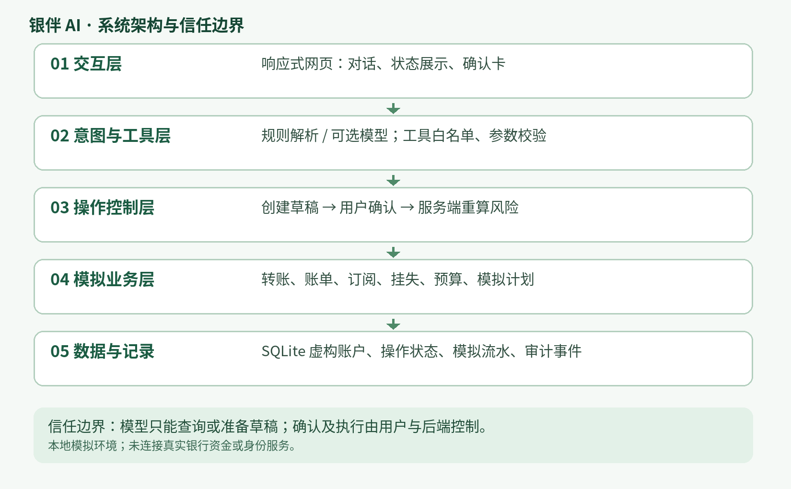

# 银伴 AI｜银行智能体参赛原型

## 1. 项目简介

- 参赛赛道：2026 深圳国际金融科技大赛人工智能国内赛道（银行 AI 智能体）
- 项目名称：银伴 AI——面向日常金融服务的银行智能体
- 简介：自然语言入口连接模拟转账、账单、订阅与预算任务，结合工具调用、用户确认、风险校验与操作记录。

## 2. 系统架构



前端 Web → HTTP API → 规则解析或可选模型工具 → 服务端确认与风险规则 → SQLite 模拟账本。模型无法直接确认或执行交易。生日任务采用固定依赖流程，非通用 DAG。业务数据均由程序生成，账户和交易均为模拟。

## 3. 环境与依赖

Python 3.9 或更高版本，运行时无需第三方包；支持 Python 标准库可用的常见桌面操作系统。无需外部 API 即可启动规则模式。运行时在 `src/` 自动创建 `bankmate.db`；请勿上传真实数据或 API 密钥。

## 4. 安装与运行

```bash
cd src
python3 app.py
```

Windows 可用 `python app.py`。在同机浏览器访问 `http://localhost:8000`。也可设置环境变量 `PORT` 修改端口；只在可信演示网络使用。可选外部大模型配置及操作示例见 `src/README.md` 和 `src/.env.example`。程序不自动加载 `.env`。

## 5. 测试

```bash
cd src
python3 -m unittest discover -s tests -v
```

本版 49 项测试通过，详见 `evidence/test-report.md` 与 `evidence/test-run.txt`。测试使用临时 SQLite；模型与 Plaid 沙箱的自动化测试使用模拟响应。一次 OVHcloud 只读真实模型联调记录见 `evidence/live-model-probe.json`。

## 6. 部署和仓库

参赛作品可在本机直接运行；未配置公开在线部署。在线代码仓库地址为可选信息，应由团队填写真实地址，不使用示例占位链接。更多目录及模型配置说明参见 `src/README.md`。

## 7. 安全与边界

只读查询自动；模拟写操作须确认；模拟挂失或当日累计超过 1000 元的转账还需要固定演示码 `246810`。演示码不是真实多因子认证。单用户演示不具备生产身份认证、用户隔离或 CSRF 防护，不连接真实银行、不执行真实支付或推送。余额、交易及回执均来自本地模拟账本。切换模型供应商会向该供应商发送用户输入和相应工具结果，须仅使用获授权的虚构数据。执行代码与外部交易的生产级沙箱、通用任务 DAG 和分布式事务不在本版本范围内。

## 六场景与模拟边界

详见 src/README.md。六个方向均有代表性模拟功能，但不等同于全部细项完成：真实银行、真实多因子、真实商家下单和自动调度均未接入。
